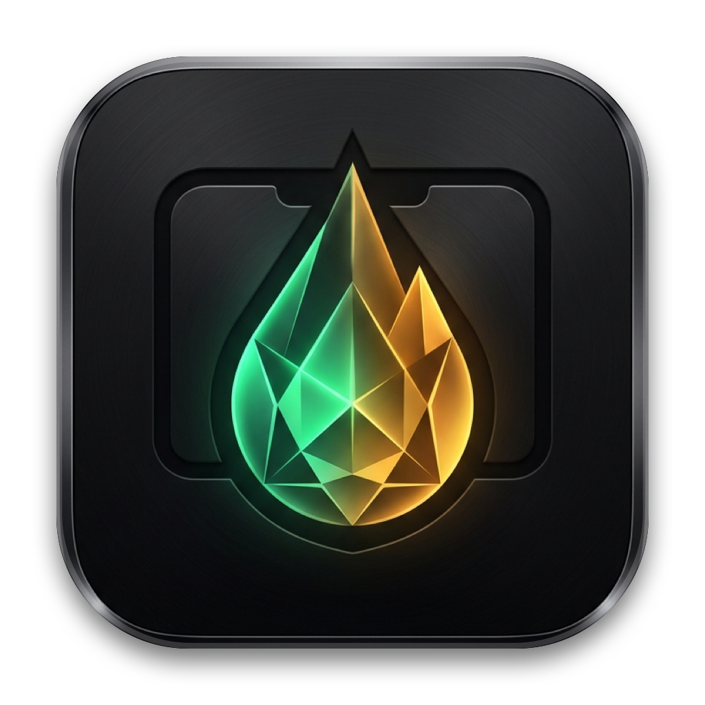

  

<h1 align="center">Samogon — Notch Tool for macOS</h1>

<b>Air-Gapped, Zero-Trust Native macOS Notch Swiss Knife (Swift 6)</b>

## Features
- **Universal Audio Mixer & Media Controller:** Independent per-app volume control (`CATapDescription` + CoreAudio Aggregate Device) and real-time Now Playing across Spotify, Brave, Safari, and native players.
- **IOKit Caffeinate Engine:** Direct kernel-level `IOPMAssertion` display and system wake locks with zero background daemons.
- **Zero-Copy File Shelf:** Drag-and-drop file dock in the notch using security-scoped in-memory bookmarks and QuickLook preview.
- **AutoRaise (Focus-Follows-Mouse):** Event-driven window activation and raising with customizable hover delay.
- **Scrolling Capture:** Native `ScreenCaptureKit` + Apple `Vision` (`VNTranslationalImageRegistrationRequest`) automatic scrolling screenshot stitching.
- **100% Air-Gapped (`0 Sockets`):** Built strictly with native Apple frameworks in Swift 6. Zero network calls, zero third-party dependencies.

## Build & Run

    swift build -c release
    open Samogon.app
